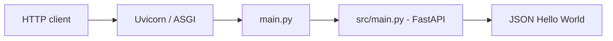

# Architecture — Tổng quan

## Hiện trạng
Ứng dụng Python/FastAPI một service. `main.py` ở gốc import `app` từ `src/main.py` để giữ entrypoint cũ. `src/main.py` đăng ký route HTTP `GET /`; không có lớp database, service nghiệp vụ hay message broker.

## Các thành phần
| Thành phần | Trách nhiệm | Lý do tồn tại |
| --- | --- | --- |
| `main.py` | Import và re-export `app`, `home` | Tương thích lệnh chạy `main:app` |
| `src/main.py` | Tạo ứng dụng và khai báo route | Code ứng dụng được quản lý trong `src/` |
| `tests/` | Test hành vi public qua HTTP | Phát hiện regression khi refactor |
| `docs/` | Mô tả hiện trạng và quyết định | Hỗ trợ người và AI đọc thống nhất |

## Ranh giới
- API hiện hữu: HTTP REST-style GET `/`.
- Không có gRPC/protobuf, event bus hay data persistence.
- `snippets.txt` không được import hoặc sử dụng lúc runtime.
- Thiết kế tương lai cần requirement/ADR riêng, không suy ra từ tên repo.

## Nguồn đối chiếu
Luôn kiểm tra trực tiếp `src/main.py`, `main.py` và `tests/test_main.py` trước khi sửa tài liệu này.
