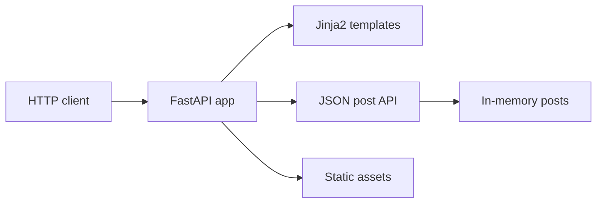

# Architecture

One FastAPI ASGI application in `src/fastapi_blog/main.py`. The root `main.py` and `src/main.py` expose the same app as compatibility entrypoints. `src/fastapi_blog/schemas.py` defines Pydantic post payloads. Jinja2 renders `templates/`; StaticFiles serves `static/`. `posts` is a process-local list, so restarting the server loses new posts.

No database, authentication, gRPC, or message bus is implemented. The code is the source of truth.
