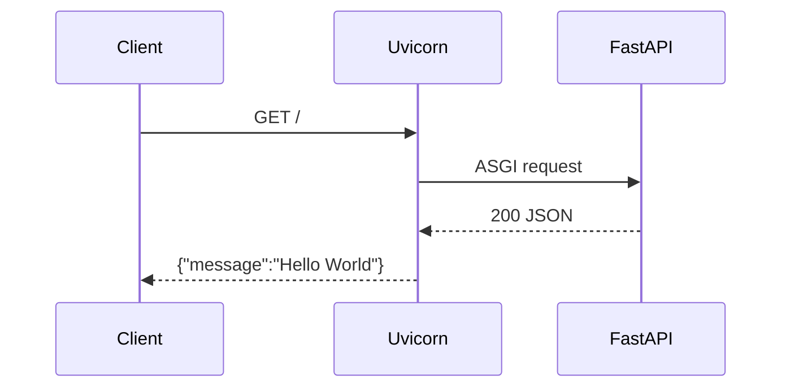

# Design — Thiết kế chi tiết

## Lựa chọn tổ chức
- `src/main.py` chứa FastAPI application thực tế.
- `main.py` ở gốc là adapter import, nhằm tránh breaking change với `uvicorn main:app`.
- Chưa tách routers/services/repositories vì hiện chỉ có một route; tách sớm sẽ tạo abstraction không cần thiết.
- Không thay `pyproject.toml` và `uv.lock` vì refactor không cần dependency mới.

## Luồng xử lý GET /
1. ASGI server load `main:app`.
2. Root entrypoint re-export ứng dụng từ `src.main`.
3. FastAPI định tuyến `GET /` tới `home()`.
4. `home()` trả về dictionary; FastAPI serialize thành JSON.

## Nguyên tắc mở rộng (chưa triển khai)
Chỉ thêm routers, persistence, authentication hoặc API bài viết khi có requirement được xác nhận. Mọi thay đổi contract phải cập nhật `docs/api.md`, test và ADR khi ảnh hưởng kiến trúc.

## Trade-off
Giữ entrypoint gốc thêm một lớp import nhỏ, đổi lại các lệnh chạy hiện có không phải sửa. Xem [ADR-0001](decisions/0001-project-structure.md).
